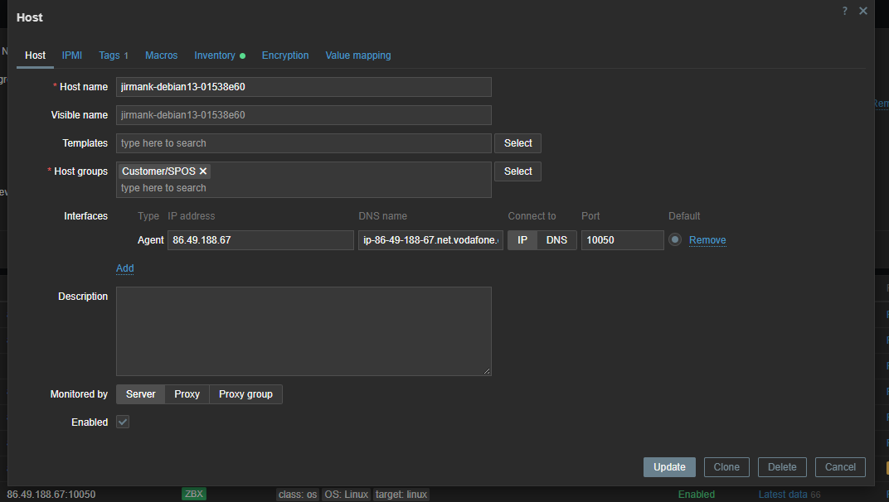
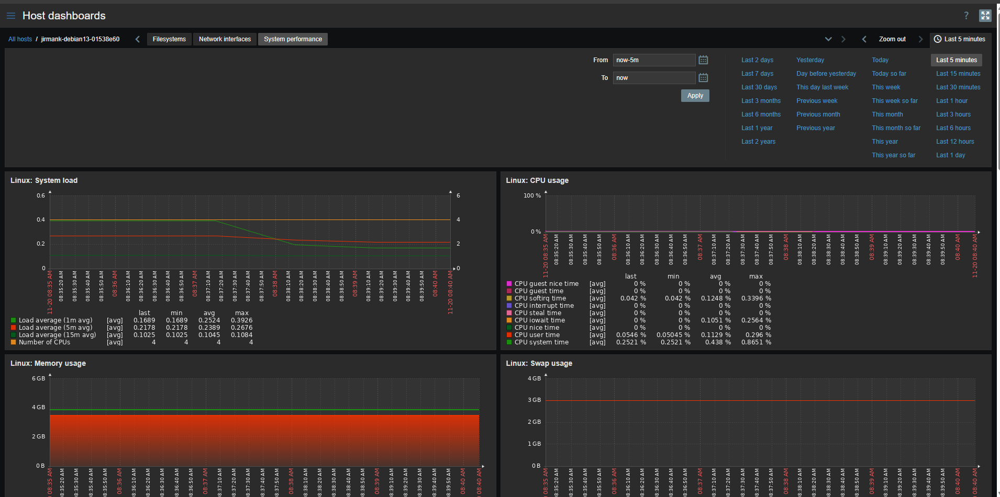

# OSY: Automatická registrace Debianu 13 do Zabbixu


Vagrant spustí virtuální stroj s **Debianem 13** (`bento/debian-13`), automaticky na něj nainstaluje **Zabbix Agent 2 8.0 LTS** z oficiálního repozitáře Zabbixu a zaregistruje ho na server `enceladus.pfsense.cz`.


## Postup práce

1. Ze šablony jsem vytvořil vlastní repozitář a smazal nepoužité soubory (`Example/`, `Vagrant/`).
2. Z `Vagrant/Vagrantfile-debian` jsem vytvořil `Vagrantfile` a přidal do něj dva shell provisionery.
3. `install-zabbix-agent2.sh` přidá oficiální repozitář Zabbix 8.0 pro Debian 13 a nainstaluje balíček `zabbix-agent2`.
4. `configure-zabbix-agent2.sh` nastaví agenta (`Server`, `ServerActive`, `Hostname`, `HostMetadata`) a restartuje službu.
5. Po spuštění jsem v Zabbixu ověřil, že se host zaregistroval a přicházejí z něj data.

## Soubory

| Soubor | Popis |
| --- | --- |
| `Vagrantfile` | Box Debian 13 a dva provisionery |
| `install-zabbix-agent2.sh` | Instalace Zabbix Agent 2 8.0 LTS z oficiálního repozitáře |
| `configure-zabbix-agent2.sh` | Konfigurace agenta a automatická registrace |
| `Images/` | Snímky obrazovky z Zabbixu a obrázky k dokumentaci |

## Konfigurace agenta

V `/etc/zabbix/zabbix_agent2.conf` se nastavuje:

| Parametr | Hodnota |
| --- | --- |
| `Server` | `enceladus.pfsense.cz` |
| `ServerActive` | `enceladus.pfsense.cz` |
| `HostMetadata` | `SPOS` |
| `Hostname` | jedinečný název, např. `jirmank-debian13-01538e60` |

Název hosta se vytvoří jen při prvním spuštění a uloží se do souboru ve virtuálním stroji. Při restartu i při opakovaném `vagrant provision` se použije stejný, takže se host v Zabbixu neduplikuje. Po `vagrant destroy` vznikne nový.

Automatická registrace probíhá tak, že agent naváže aktivní spojení se serverem a pošle svůj `Hostname` a `HostMetadata=SPOS`. Server podle toho použije připravené pravidlo, host přidá a přiřadí mu skupinu, štítky a šablonu pro Linux.

## Spuštění

Je potřeba mít nainstalovaný Vagrant a VirtualBox. V adresáři repozitáře spusťte:

```powershell
vagrant validate
vagrant up
```

Po změně skriptů lze znovu spustit provisioning:

```powershell
vagrant provision
```

## Ověření

Do virtuálního stroje se přihlásíte příkazem `vagrant ssh`. Tam spusťte:

```bash
zabbix_agent2 -V
systemctl status zabbix-agent2
grep -E '^(Hostname|Server|ServerActive|HostMetadata)=' /etc/zabbix/zabbix_agent2.conf
nc -z -w 5 enceladus.pfsense.cz 10051 && echo "server dostupný"
journalctl -u zabbix-agent2 --no-pager | tail -30
```

### Registrace hosta v Zabbixu

Host `jirmank-debian13-01538e60` je v Zabbixu na `enceladus.pfsense.cz` zaregistrovaný, má stav Enabled a štítky `class: os`, `OS: Linux`, `target: linux`:



### Přijímaná data

V sekci Latest data přicházejí z hosta aktuální hodnoty:



## Zdroje

- [Zabbix 8.0: instalace z balíčků](https://www.zabbix.com/documentation/8.0/en/manual/installation/install/packages)
- [Zabbix 8.0: automatická registrace](https://www.zabbix.com/documentation/8.0/en/manual/discovery/auto_registration)
- [Zabbix 8.0: parametry agenta 2](https://www.zabbix.com/documentation/8.0/en/manual/concepts/agent2/agent2_params)